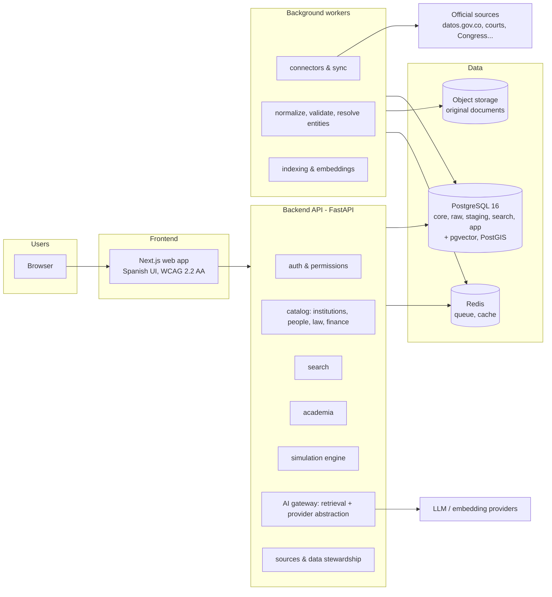

# NEXO Colombia — System Architecture

Version 0.1 · 2026-11-17 · Status: **Diseñado** (proposed). Decisions are recorded as ADRs in Section 6 and can be revised when the prototype folder and hosting constraints are known.

## 1. Overview

NEXO is designed as a **modular monolith**: one backend application with clearly separated internal modules, one PostgreSQL database, one background worker and one web frontend. This is the simplest structure that meets the requirements, and each module can later be split out if load or team size demands it.



## 2. Components and responsibilities

| Component | Responsibility | Does not do |
|---|---|---|
| **Frontend** (Next.js, React, TypeScript, Tailwind, accessible component library) | Rendering, navigation, forms, visualizations, i18n (es default, en later) | No business rules, no direct database access, no secrets |
| **API** (Python, FastAPI, Pydantic) | Authentication, authorization, all reads and writes, search queries, simulation, AI orchestration; versioned REST under `/api/v1` | No scraping or long jobs in request handlers |
| **Workers** (same codebase, task queue on Redis) | Connectors, sync scheduling, parsing, normalization, entity resolution, indexing, embeddings | No user-facing responses |
| **PostgreSQL** | Single source of truth: raw snapshots, staging, canonical model, full-text (Spanish), vectors (pgvector), geography (PostGIS), app data | |
| **Redis** | Task queue, rate limiting, short-lived cache | No durable data |
| **Object storage** (S3-compatible) | Original PDFs, DOCX, HTML snapshots, uploads | |
| **AI gateway** (module inside the API) | Retrieval, prompt assembly, provider-agnostic calls, citation checking, evaluation hooks | Never answers without retrieved evidence |

## 3. Backend module boundaries

```
backend/
  app/
    core/          settings, security, db session, audit
    auth/          users, roles, permissions
    catalog/       institutions, people, positions, parties
    legislation/   instruments, provisions, initiatives, votes, jurisprudence
    finance/       contracts, budgets
    academia/      courses, lessons, quizzes, glossary
    search/        unified search, filters
    simulation/    procedure rules, calculators
    ai/            retrieval, prompts, providers, evaluation
    sources/       source registry, sync status, data quality
  ingestion/
    connectors/    one module per source (socrata.py, ...)
    pipeline/      raw → staging → core, validation, entity resolution
  migrations/      Alembic
  tests/
frontend/          Next.js app
docs/              this documentation
infra/             docker-compose, CI
```

Rule: modules talk to each other through their service interfaces, not by reaching into each other's tables. Ingestion writes `core` only through the pipeline.

## 4. Data ingestion strategy

Every source follows the same four steps, so behaviour is predictable and auditable:

1. **Acquire.** A connector fetches data using the most structured channel available (API before download before HTML before PDF), respecting robots.txt, terms, crawl delays and rate limits, and identifying itself honestly. The exact response is stored in `raw` with a content hash. Nothing behind authentication is accessed.
2. **Parse and validate.** Rows are typed and checked in `staging`. Invalid or placeholder rows are rejected with a reason and counted in the sync report (for example the "FALLA EN EL APLICATIVO" row found in the Cámara dataset).
3. **Minimize.** A per-source **field allow-list** decides what may enter `core`. Fields not on the list (bank accounts, personal ID numbers, private contact details) are dropped here.
4. **Resolve and publish.** Entities are matched by official identifiers first (NIT, official codes), by normalized names only with a human-reviewable confidence. Changes create new versions; history is kept. Search indexes are refreshed.

Sync modes: incremental (by the source's update timestamp where it exists, such as `ultima_actualizacion` in SECOP II) and periodic full reconciliation. Failures retry with backoff and raise an alert; a failed run never modifies `core`.

For the generic datos.gov.co connector: page with `$limit`/`$offset` ordered by a stable key, at most one request per second (the portal's stated crawl delay), optional app token kept in server-side secrets.

## 5. Cross-cutting designs

### 5.1 Security architecture

- **Authentication:** server-managed sessions in HTTP-only, Secure, SameSite cookies; passwords hashed with a modern algorithm (Argon2id); optional single sign-on later.
- **Authorization:** role-based, enforced in API dependencies on every route; the frontend only hides what the API already forbids. Implemented roles (M4, staff only, the public site has no accounts): administrator, data steward, legal reviewer. Public user accounts are not planned for the MVP (owner decision of 2026-11-18). See ADR-006.
- **Input and output:** Pydantic validation on all inputs; parameterized queries only; output encoding by React; strict Content Security Policy; CSRF tokens on state-changing requests.
- **Files:** uploads are type-checked, size-limited, stored outside the web root, parsed in an isolated worker.
- **Rate limiting** per IP and per account; **audit log** for sign-ins, role changes, imports, rollbacks, exports. Implemented in M4: per-account lockout and an append-only audit log (`core.audit_event`, protected by a database trigger) of sign-ins, failed sign-ins, sign-outs, password changes, account changes and data synchronizations, without IP addresses. Per-IP limits are enforced by the Caddy reverse proxy in production (ADR-006, docs/06).
- **Secrets:** environment-injected, never committed; `.env.example` documents names only.
- **Backups:** daily database dumps plus object-storage versioning; restore tested in Phase 6.
- **Privacy:** field allow-lists at ingestion; `restricted` schema for matching identifiers; public views exclude protected data; documented classification of each field as public-interest or protected.

### 5.2 Search

MVP: PostgreSQL full-text search with the Spanish configuration and unaccented matching, one `search.document` table fed from all record types (type, title, body, filters, link). Phase 4 adds embeddings in pgvector and hybrid ranking, then reranking.

### 5.3 AI and retrieval (Phase 4)

Pipeline: parse → extract text (OCR only when needed) → chunk by legal structure (article, section, considerando) → enrich with metadata (source, date, validity) → embed → hybrid retrieve → rerank → assemble prompt (rules first, retrieved documents in delimited blocks, question and answer format last) → generate → verify that every citation maps to a retrieved chunk → return in the Legal Answer format. Retrieved content is treated as untrusted data. Providers sit behind one interface (`generate`, `embed`), with credentials server-side. An evaluation suite of representative questions is run on every change.

### 5.4 Simulation engine (Phase 5)

Pure, deterministic functions over `procedure_rule` rows. Each rule cites its constitutional or statutory provision and carries a verification record. The engine refuses to run a rule that is not verified. Candidate legal bases to encode, **pending verification against official texts** (Interpretación jurídica until verified): Constitución Política arts. 145 and 146 (quorum and general majority rule), 151 (organic laws), 153 (statutory laws), 375 (constitutional amendments), and Ley 5 de 1992 (Reglamento del Congreso).

### 5.5 Observability

Structured logs, request IDs, sync-run metrics per source, error tracking, health endpoints. A "Fuentes" page shows each source's last successful sync publicly.

## 6. Architecture Decision Records

### ADR-001: Modular monolith instead of microservices
- **Status:** Proposed
- **Context:** Six modules share one data model and heavy cross-linking; the team is small; requirements call for modularity without unnecessary complexity.
- **Options considered:** (A) modular monolith; (B) microservices per module; (C) serverless functions.
- **Analysis:** B and C add network boundaries, deployment and consistency problems exactly where the product needs joins across domains. A keeps transactions and queries simple, and module boundaries in code preserve the option to split later.
- **Decision:** A.
- **Consequences:** One deployable API plus workers; discipline needed to keep module boundaries; scaling is vertical first, then by separating workers.

### ADR-002: PostgreSQL as the single datastore (relational, graph, text, vector, geo)
- **Status:** Proposed
- **Context:** The brief asks to evaluate PostgreSQL before adding a graph database. Needs: temporal relational data, graph traversal of a few hops, Spanish full-text search, semantic search, maps.
- **Options considered:** (A) PostgreSQL with recursive queries, pgvector, PostGIS, full-text; (B) PostgreSQL plus a graph database; (C) PostgreSQL plus a search engine such as OpenSearch.
- **Analysis:** Expected graph queries are bounded paths (up to about six hops) from a starting entity, which recursive SQL handles on indexed edge tables. A second store would require synchronization and a second security model. Volume check: the largest verified source has about 9 million rows, well within PostgreSQL's range.
- **Decision:** A. Revisit if measured traversal or search latency exceeds targets.
- **Consequences:** One backup, one permission model, simpler operations; graph algorithms such as centrality would need an extension or export later.

### ADR-003: Next.js frontend with a Python (FastAPI) backend
- **Status:** Proposed
- **Context:** Needs an accessible, server-rendered, SEO-friendly Spanish site and a backend strong in data processing, document parsing and AI tooling.
- **Options considered:** (A) Next.js + FastAPI; (B) full-stack TypeScript; (C) Django with templates.
- **Analysis:** Python has the best libraries for ingestion (pandas/polars, PDF and HTML parsing) and AI. Next.js gives accessible, fast pages and rich visualization. B would split data tooling across languages anyway; C weakens the interactive UI.
- **Decision:** A, with an OpenAPI contract generating the frontend client types.
- **Consequences:** Two languages to maintain; a clear API boundary that also serves future integrations.

### ADR-004: Append-only raw layer and versioned canonical records
- **Status:** Proposed
- **Context:** The brief requires traceability, history and no silent overwrites; sources change and sometimes contain errors.
- **Options considered:** (A) raw → staging → core with versions; (B) load directly into final tables and update in place.
- **Analysis:** B loses the ability to show what a source said on a given date and to roll back a bad import. A costs storage but makes provenance, rollback and conflict display straightforward.
- **Decision:** A.
- **Consequences:** More storage and pipeline code; every fact is reproducible from its raw snapshot.

### ADR-005: Start with official open-data APIs, postpone scraping
- **Status:** Proposed
- **Context:** Verification on 2026-11-17 showed current, licensed (CC BY-SA 4.0) datasets on datos.gov.co for entities, Cámara bills, budget execution and SECOP, while several legal-text sites are not yet reachable.
- **Options considered:** (A) build the MVP on verified APIs; (B) begin with scraping legal and congressional sites.
- **Analysis:** A delivers real data fastest with the least legal and technical risk and exercises the whole pipeline. B is necessary later for legal texts, gacetas and jurisprudence, and benefits from a pipeline that already works.
- **Decision:** A for the MVP; scraping connectors in Phase 3, each after a documented check of terms and robots.txt.
- **Consequences:** MVP coverage of legal texts is small (Constitution plus a curated set); debate histories and Cámara votes arrive later.

### ADR-006: Staff sessions as opaque tokens held by the web server
- **Status:** Proposed
- **Context:** M4 adds sign-in for staff only (owner decision of 2026-11-18: administration, data stewards, legal reviewers; built-in e-mail and password). The browser talks to the Next.js server, which calls the API from the server.
- **Options considered:** (A) opaque random session tokens stored hashed in PostgreSQL; the web server keeps the token in an HTTP-only, SameSite=Strict cookie and sends it to the API as a bearer token; (B) signed stateless tokens (JWT) in the cookie; (C) an external identity provider.
- **Analysis:** A can be revoked at once (sign-out, password or role change, deactivation), keeps the API free of cookies and therefore of cross-site request forgery, and needs no new service. B cannot be revoked before expiry without a deny list, which brings back the database lookup. C adds a vendor and a hosting dependency for a handful of accounts.
- **Decision:** A. Passwords are hashed with Argon2id; five failed sign-ins lock an account for 15 minutes; sessions last at most 12 hours and end after 2 hours idle; every staff route checks the role in the API.
- **Consequences:** one database read per staff request. Per-IP rate limiting cannot be done well in the API (it sees the web server's address); it is done by the reverse proxy (Caddy, `deploy/caddy/Caddyfile`). Single sign-on can be added later beside A.

## 7. API outline (v1)

| Area | Endpoints (GET unless noted) |
|---|---|
| Search | `/search?q=&type=&from=&to=&filters…` |
| Institutions | `/institutions`, `/institutions/{id}`, `/institutions/{id}/positions`, `/institutions/{id}/budget`, `/institutions/{id}/contracts` |
| People | `/people`, `/people/{id}`, `/people/{id}/positions`, `/people/{id}/affiliations`, `/people/{id}/votes` |
| Positions in time | `/positions/{id}/holder?on=YYYY-MM-DD` |
| Legislation | `/initiatives`, `/initiatives/{id}`, `/initiatives/{id}/events`, `/instruments`, `/instruments/{id}`, `/provisions/{id}`, `/provisions/{id}/versions` |
| Finance | `/contracts`, `/contracts/{id}`, `/budgets` |
| Graph | `/entities/{type}/{id}/relationships?depth=` |
| Academia | `/courses`, `/courses/{id}`, `/lessons/{id}`, `/glossary`, `POST /quizzes/{id}/attempts` |
| Provenance | `/records/{type}/{id}/provenance`, `/sources`, `/sources/{id}/sync-runs` |
| Auth | `POST /auth/login`, `POST /auth/logout`, `/auth/me` |
| Admin | `POST /imports`, `POST /imports/{id}/rollback`, `/audit-log` (role-restricted) |
| Later | `POST /assistant/query`, `POST /simulations`, `/workspaces…` |

Every record response includes `provenance`, `data_quality_status` and, where relevant, `epistemic_label`.

## 8. Development and deployment

Local: Docker Compose (PostgreSQL with pgvector and PostGIS, Redis, object-storage emulator, API, worker, web). CI: lint, type checks, unit and integration tests, migration check, accessibility checks on core pages. Deployment target: to be decided with the owner (open question in the PRD); the design runs on a single modest server or any container platform.
