# NEXO Colombia — Data Model and Knowledge Graph

Version 0.1 · 2026-11-17 · Status: **Diseñado**. Nothing here is implemented yet.

## 1. Design principles

1. **Provenance on everything.** Every public row points to a `source_record` (the raw item it came from). No orphan facts.
2. **History is first-class.** Changing facts (who holds an office, party membership, a contract's state, the text of an article) live in rows with `valid_from` / `valid_to`. Updates close the old row and open a new one; they never overwrite.
3. **Entities are separate from their attributes over time.** A `person` is permanent; a `position_holding` is a dated fact about that person.
4. **One relationship model.** All cross-entity links that are not core foreign keys live in `relationship`, each with source, dates, type and confidence class. This table is the knowledge graph.
5. **Labels are data.** Epistemic Label, confidence class and data-quality status are columns, so the UI and the AI layer cannot forget them.
6. **Privacy by schema.** Sensitive identifiers are stored only where needed for matching, in a restricted schema, never in public views.
7. **Jurisdiction is explicit** (`jurisdiction_code`, default `CO`), so regional expansion needs no redesign.

## 2. Layers

| Layer (PostgreSQL schema) | Purpose | Who reads it |
|---|---|---|
| `raw` | Exact snapshots of what each source returned (JSON or file reference), append-only | Ingestion only |
| `staging` | Parsed, typed, validated rows per source, with rejects and reasons | Ingestion, data stewards |
| `core` | Canonical entities, facts and relationships (this document) | API |
| `restricted` | Identifiers needed for entity resolution (for example natural-person document numbers, hashed) | Entity-resolution job only |
| `search` | Full-text and vector indexes derived from `core` | API |
| `app` | Users, roles, workspaces, audit log | API |

## 3. Core entities

All `core` tables share: `id` (UUID), `jurisdiction_code`, `source_record_id`, `data_quality_status`, `created_at`, `updated_at`. Dated tables add `valid_from`, `valid_to`, `recorded_at`.

### 3.1 Provenance

| Table | Key columns |
|---|---|
| `source` | name, institution, url, category, acquisition_method, update_frequency, reliability_class (1–7), access_restrictions, known_limitations, licence, verification_status, last_verified_at |
| `sync_run` | source_id, started_at, finished_at, mode (incremental/full), rows_seen, rows_new, rows_changed, rows_rejected, status, error |
| `source_record` | source_id, sync_run_id, external_id, original_url, acquired_at, published_at, last_verified_at, raw_ref (pointer into `raw`), content_hash, extraction_method, processing_history (JSON) |
| `document` | title, document_type, original_url, file_ref (object storage), mime_type, content_hash, published_at, text_extracted (boolean), ocr_used (boolean) |
| `dataset` | name, description, source_id, licence, row_count, last_updated |

### 3.2 People, institutions and offices

| Table | Key columns | Notes |
|---|---|---|
| `person` | full_name, name_normalized | No document numbers here |
| `institution` | name, official_code, nit, branch_id, order (national/territorial), sector, legal_nature, parent_institution_id, department, municipality, website | NIT of legal entities is public |
| `government_branch` | name (legislativa, ejecutiva, judicial, órganos autónomos, organización electoral, organismos de control) | |
| `public_position` | title, institution_id, position_type (elected/appointed/career), legal_basis_provision_id | The office itself |
| `position_holding` | person_id, public_position_id, valid_from, valid_to, how_obtained (election/appointment/replacement), constituency, source_record_id | "PublicOfficial" is a person with at least one holding |
| `political_organization` | name, kind (party/movement/coalition/significant group of citizens), legal_status | Covers PoliticalParty and PoliticalMovement |
| `political_affiliation` | person_id, organization_id, valid_from, valid_to, basis (elected under/declared/reported) | Dated, so past affiliations never show as current |
| `legislative_term` | chamber-independent period (cuatrienio) and `legislature` (annual) rows | |
| `congressional_commission` | name, chamber, kind (constitucional/legal/especial/accidental) | |
| `commission_membership` | person_id, commission_id, role, valid_from, valid_to | |

### 3.3 Law and legislation

| Table | Key columns | Notes |
|---|---|---|
| `legal_instrument` | instrument_type (constitución, acto legislativo, ley, decreto legislativo, decreto ordinario, decreto reglamentario, resolución, acto administrativo, reglamento, circular…), number, year, title, issuing_institution_id, hierarchy_level, promulgated_at, official_publication_ref, status (vigente/derogada/…) | |
| `legal_provision` | instrument_id, path (título/capítulo/artículo/parágrafo), label | The stable identity of an article |
| `provision_version` | provision_id, text, valid_from, valid_to, amended_by_instrument_id | Enables version comparison |
| `legislative_initiative` | camara_number, senado_number, legislature_id, title, summary, law_type (ordinaria, estatutaria, orgánica, marco, acto legislativo…), origin_chamber, current_status, final_outcome, resulting_instrument_id | |
| `initiative_author` | initiative_id, person_id or institution_id, role (autor/ponente) | |
| `initiative_event` | initiative_id, event_type (radicación, publicación, ponencia, debate, votación, conciliación, sanción, objeción, revisión constitucional, archivo, retiro…), chamber, commission_id, occurred_at, document_id | The procedural history |
| `legislative_debate` | initiative_id, stage (first/second/third/fourth debate, or rounds for constitutional amendments), chamber, commission_id, date | |
| `legislative_vote` | debate_id, voting_procedure (nominal/ordinaria/secreta), yes_total, no_total, abstentions, absences, quorum_recorded, result, individual_votes_available (boolean) | Aggregates always; individuals only if the source lists them |
| `individual_vote` | vote_id, person_id, value | Only populated from sources that record each member's vote |
| `judicial_body` | name, jurisdiction_kind | |
| `court_decision` | judicial_body_id, identifier (for example sentence number), decision_date, reporting_judge_person_id, legal_question, facts, reasoning, decision, document_id | |
| `decision_opinion` | decision_id, person_id, kind (salvamento/aclaración) | |
| `citation` | from (decision or instrument), to (provision, decision or instrument), kind | Feeds "subsequent treatment" |

### 3.4 Public finance

| Table | Key columns | Notes |
|---|---|---|
| `company` | legal_name, nit, company_type | Legal entities only |
| `corporate_representative` | company_id, person_id, role, valid_from, valid_to | Only from official records |
| `contract` | external_id, contracting_institution_id, contractor_company_id or contractor_person_id, purpose, contract_type, procurement_method, signed_at, start_at, end_at, status, funding_source, process_url | Built 2026-11-24 as `core.contract` (source_key, entity_name, entity_nit, institution_id set by the NIT rule A-016, supplier_kind, supplier_name and supplier_nit only for suppliers with a NIT (A-015), the five published amounts, process_url). Rolling 90-day window |
| `contract_amount` | contract_id, amount_kind (**awarded / contracted / invoiced / paid / pending**), value, currency, as_of | Different concepts are different rows, never one "value" column |
| `contract_amendment` | contract_id, kind (adición, prórroga…), value_change, days_added, date | |
| `contract_bidder` | process external id, bidder company/person, awarded (boolean) | |
| `budget` | institution_id, fiscal_year, budget_item_code, item_name, funding_source | |
| `budget_execution` | budget_id, as_of, **appropriation**, **commitments**, **obligations**, **payments** | Four separate columns, as in the Ministry of Finance dataset |
| `entity_mapping` | kind (budget_entity, contract_entity), source_value (budget code, or NIT and normalized name), source_name, institution_id, note, created_by | Built 2026-11-24: links reviewed by the data team (A-017), applied before the automatic rules |
| `budget_snapshot` | entity_code, **published_on** (the source's update date), the four totals, line_count | Built 2026-11-24: one row per entity and source update, so change between updates can be shown; not a fiscal period (A-011, A-013) |
| `public_program` | name, institution_id, description | |

### 3.5 Education and simulation

| Table | Key columns |
|---|---|
| `educational_course` | title, learning_path, level, status |
| `educational_lesson` | course_id, order, title, body, reviewed_by, reviewed_at |
| `lesson_link` | lesson_id, target_type, target_id (links lessons to live records) |
| `quiz`, `quiz_question`, `quiz_attempt` | standard quiz structures |
| `glossary_term` | term, definition, source_provision_id |
| `procedure_rule` | law_type, stage, chamber_scope, quorum_rule, majority_rule, legal_basis_provision_ids, verified_by, verified_at | Rules for the simulation engine; each must cite its provision and be verified before use |
| `simulation` | user_id, initiative_id (optional), procedure_rule_id, assumptions (JSON), result (JSON), created_at | Always labelled "Simulación hipotética" |

### 3.6 The relationship table (knowledge graph)

`relationship`: `subject_type`, `subject_id`, `predicate`, `object_type`, `object_id`, `valid_from`, `valid_to`, `confidence_class`, `epistemic_label`, `source_record_id`, `method_note`, `evidence` (the words in the source the link rests on, as published). Built on 2026-11-24 (`backend/app/core/relationships.py`); one link per subject, predicate and object.

Predicates in use: `author_of` (person → legislative_initiative), class `analytical_association`, label `hipotesis_analitica`, made by the exact-name rule A-012; `source_record_id` points to the bill whose list of authors it was read from, `evidence` holds the name as published. `has_budget_line` (institution → budget_execution), same class and label, made by the exact-name rule A-014; one link per budget line of the matched entity, `source_record_id` points to that line's raw record, `evidence` holds the budget entity name as published; a link reviewed by the data team (A-017) has method `revision_manual` and the reviewer's reason as evidence.

- `confidence_class`: verified_official · declared · reported · historical · analytical_association · unverified_claim.
- `epistemic_label`: hecho_documentado · interpretacion_juridica · hipotesis_analitica · simulacion_hipotetica · no_verificado.
- A database constraint requires `source_record_id` for every class except `analytical_association`, which requires `method_note` instead.
- Rows with class `unverified_claim` are never exposed publicly.

Graph traversal ("official → position → institution → commission → bill → vote → company → contract") is done with recursive SQL over `relationship` plus the core foreign keys. See ADR-002 in the architecture document for why a separate graph database is not introduced yet.

## 4. Entity-relationship overview

```mermaid
erDiagram
    SOURCE ||--o{ SOURCE_RECORD : provides
    SOURCE ||--o{ SYNC_RUN : has
    PERSON ||--o{ POSITION_HOLDING : holds
    PUBLIC_POSITION ||--o{ POSITION_HOLDING : "held through"
    INSTITUTION ||--o{ PUBLIC_POSITION : defines
    GOVERNMENT_BRANCH ||--o{ INSTITUTION : groups
    PERSON ||--o{ POLITICAL_AFFILIATION : has
    POLITICAL_ORGANIZATION ||--o{ POLITICAL_AFFILIATION : receives
    PERSON ||--o{ COMMISSION_MEMBERSHIP : sits
    CONGRESSIONAL_COMMISSION ||--o{ COMMISSION_MEMBERSHIP : includes
    LEGISLATIVE_INITIATIVE ||--o{ INITIATIVE_AUTHOR : "authored by"
    LEGISLATIVE_INITIATIVE ||--o{ INITIATIVE_EVENT : "progresses through"
    LEGISLATIVE_INITIATIVE ||--o{ LEGISLATIVE_DEBATE : debated
    LEGISLATIVE_DEBATE ||--o{ LEGISLATIVE_VOTE : "decided by"
    LEGISLATIVE_VOTE ||--o{ INDIVIDUAL_VOTE : "may list"
    PERSON ||--o{ INDIVIDUAL_VOTE : casts
    LEGISLATIVE_INITIATIVE |o--o| LEGAL_INSTRUMENT : "becomes"
    LEGAL_INSTRUMENT ||--o{ LEGAL_PROVISION : contains
    LEGAL_PROVISION ||--o{ PROVISION_VERSION : "versioned as"
    JUDICIAL_BODY ||--o{ COURT_DECISION : issues
    COURT_DECISION ||--o{ CITATION : cites
    INSTITUTION ||--o{ CONTRACT : awards
    COMPANY ||--o{ CONTRACT : performs
    CONTRACT ||--o{ CONTRACT_AMOUNT : "valued by"
    CONTRACT ||--o{ CONTRACT_AMENDMENT : amended
    COMPANY ||--o{ CORPORATE_REPRESENTATIVE : "represented by"
    INSTITUTION ||--o{ BUDGET : allocated
    BUDGET ||--o{ BUDGET_EXECUTION : executed
    EDUCATIONAL_COURSE ||--o{ EDUCATIONAL_LESSON : contains
    EDUCATIONAL_LESSON ||--o{ LESSON_LINK : "links to records"
```

Every entity above also links to `SOURCE_RECORD`; those lines are omitted for readability.

## 5. Mapping of the brief's entity list

Person → `person` · PublicOfficial → `person` + `position_holding` · Institution → `institution` · GovernmentBranch → `government_branch` · PoliticalParty, PoliticalMovement → `political_organization` · PublicPosition → `public_position` · LegislativeTerm → `legislative_term` · CongressionalCommission → `congressional_commission` · LegislativeInitiative → `legislative_initiative` · LegalInstrument → `legal_instrument` · LegalProvision → `legal_provision` + `provision_version` · CourtDecision → `court_decision` · JudicialBody → `judicial_body` · LegislativeDebate → `legislative_debate` · LegislativeVote → `legislative_vote` + `individual_vote` · Contract → `contract` · Company → `company` · CorporateRepresentative → `corporate_representative` · Budget → `budget` · Expenditure → `budget_execution` + `contract_amount` · PublicProgram → `public_program` · Dataset → `dataset` · Document → `document` · Source → `source` · Relationship → `relationship` · EducationalCourse, EducationalLesson, Quiz → same names · Simulation → `simulation` + `procedure_rule`.

## 6. How verified sources map to the model (MVP)

| Source (registry ID) | Target tables | Fields deliberately not ingested |
|---|---|---|
| Universo de entidades (S-006) | `institution`, `government_branch`, `public_position` + `position_holding` for the listed representative | Fax; personal e-mail if any |
| Proyectos de Ley, Cámara (S-008) | `legislative_initiative`, `initiative_author` (after name matching), `legislative_term` | Placeholder rows go to `staging` rejects |
| Ejecución PGN (S-005) | `budget_execution` (one row per entity, funding source, funds situation and resource; `budget` per fiscal year waits for a source that states the year) | None |
| SECOP II contratos (S-001), limited subset | `contract`, `contract_amount`, `company` (legal entities by NIT) | Bank name and account; all natural-person document numbers; legal representative's ID, gender, nationality and address; supervisors' and spending officers' IDs |
| Representantes 2026-2027 (S-010) | `person`, `position_holding` (party kept as published text until `political_organization` exists; the source has no commissions) | Nothing: the institutional e-mail, office and phone extension are stored and shown, by owner decision of 2026-11-18, as contact details of the office published by the Cámara |
| Votaciones plenaria Senado (S-009), Phase 5 | `legislative_vote`, `individual_vote` | None; absences and abstentions stay "not recorded in source" |

## 7. Data-quality status

`data_quality_status` per record is computed from documented checks: provenance complete; required fields present; identifiers valid (for example NIT check digit); dates consistent; referential links resolved; source freshness. Values: `verified`, `acceptable`, `incomplete`, `conflicting`, `stale`. It rates the record only, never a person or institution.
